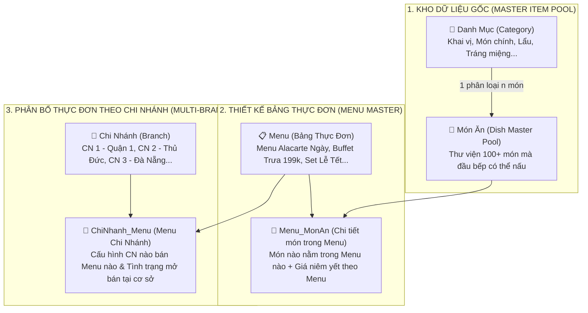

# CHECKLIST ƯU TIÊN: 9 MÀN HÌNH DANH MỤC NỀN TẢNG (MASTER DATA & CHUỖI NHÀ HÀNG)

**Dự án:** Hệ thống Quản lý Quán ăn (`Quanlyquanan`)  
**Công nghệ:** VB.NET Windows Forms (.NET 10.0) + SQL Server 2022 (Docker)  
**Liên kết Checklist tổng:** [`docs/CHECKLIST_DO_AN.md`](CHECKLIST_DO_AN.md)  
**Quy tắc đồng bộ:** Đây là 9 màn hình danh mục nền tảng (Master Data) cấu thành toàn bộ dữ liệu hoạt động cho hệ thống quán ăn / chuỗi nhà hàng. Khi hoàn thành từng màn hình tại checklist này, các hạng mục tương ứng tại **Mục 3.5** của [`docs/CHECKLIST_DO_AN.md`](CHECKLIST_DO_AN.md) sẽ được đánh dấu `[x]` hoàn thành để không phải làm lại khi quay về luồng checklist chung.

---

## 1. BẢNG TỔNG HỢP TIẾN ĐỘ 9 MÀN HÌNH DANH MỤC

| STT | Màn hình theo yêu cầu | Tên Form (`VB.NET`) | Bảng CSDL liên quan | Quyền RBAC (`Q_Tag`) | Định nghĩa & Ý nghĩa nghiệp vụ | Trạng thái |
| :-: | :--- | :--- | :--- | :--- | :--- | :-: |
| **1** | **MH Danh mục** | `frmDanhMuc` | `DanhMuc` | `CQ_QUAN_LY_THUC_DON` | Phân loại nhóm món (Khai vị, Món chính, Món nướng, Tráng miệng, Nước uống...). | `[x]` **Đã xong (`v0.2.3`)** |
| **2** | **MH Món ăn** | `frmMonAn` | `MonAn`, `DanhMuc` | `CQ_QUAN_LY_THUC_DON` | Thư viện toàn bộ các món ăn & thức uống (tên, đơn giá gốc, mô tả, bật/tắt hết món). | `[x]` **Đã xong (`v0.2.4`)** |
| **3** | **MH Ca (hiển thị danh sách)** | `frmCaLamViec` | `CaLamViec` | `CQ_XEP_LICH_LAM_VIEC` | Cấu hình danh sách các ca làm việc trong ngày (giờ vào/ra, thời lượng, mức lương ca). | `[x]` **Đã xong (`v0.2.5`)** |
| **4** | **MH Khu vực: tầng trệt, tầng 1, ...** | `frmKhuVuc` | `KhuVuc` *(đồng bộ `Ban.B_KhuVuc`)* | `CQ_QUAN_LY_BAN` | Phân chia không gian bàn (Tầng trệt, Tầng 1, VIP, Sân vườn), Cascade Update sang Bàn. | `[x]` **Đã xong (`v0.2.6`)** |
| **5** | **MH Bàn** | `frmBan` | `Ban`, `KhuVuc` | `CQ_QUAN_LY_BAN` | Quản lý 12 bàn ăn, số thứ tự, sức chứa (72 chỗ), trạng thái phục vụ và liên kết hóa đơn. | `[x]` **Đã xong (`v0.2.7`)** |
| **6** | **MH Nhân viên** | `frmNhanVien` | `NhanVien`, `TrinhDoViTinh`, `DungCuTrangPhuc` | `CQ_QUAN_LY_NHAN_SU` | Quản lý hồ sơ nhân viên (SĐT, CCCD, chức vụ, trình độ vi tính, cấp phát đồng phục, tài khoản). | `[x]` **Đã xong (`v0.2.8`)** |
| **7** | **MH Menu** *(Menu Master)* | `frmMenu` | `Menu`, `Menu_MonAn`, `MonAn` | `CQ_QUAN_LY_THUC_DON` | Quản lý các Bảng Thực Đơn kinh doanh (Alacarte, Buffet, Set cơm trưa, Menu lễ tết) & gán món vào Menu. | `[ ]` **Tiếp theo (MH 7)** |
| **8** | **MH Chi nhánh** | `frmChiNhanh` | `ChiNhanh` | `CQ_QUAN_LY_CHI_NHANH` | Quản lý danh mục cơ sở/chi nhánh chuỗi quán (Tên, địa chỉ, hotline, quản lý chi nhánh). | `[ ]` Chờ làm (MH 8) |
| **9** | **MH Menu chi nhánh** | `frmMenuChiNhanh` | `ChiNhanh_Menu`, `ChiNhanh`, `Menu` | `CQ_QUAN_LY_THUC_DON` | Phân bổ bảng thực đơn áp dụng cho từng chi nhánh (chi nhánh nào bán menu nào, giá áp dụng, thời hạn). | `[ ]` Chờ làm (MH 9) |

---

## 2. PHÂN TÍCH BRAINSTORMING: LÀM RÕ BẢN CHẤT CỤM "DANH MỤC — MÓN ĂN — MENU — CHI NHÁNH — MENU CHI NHÁNH"

Trong mô hình thực tế của ngành F&B và quản trị chuỗi quán ăn (tương tự các hệ thống ERP như Golden Gate, RedSun, iPOS, CukCuk):

### Làm rõ câu hỏi: "MH Menu" khác gì "MH Danh mục" & "MH Món ăn"?
1. **`MH Danh mục` (Category):** Là sự phân chia nhóm thức ăn theo tính chất ẩm thực (Ví dụ: Nhóm Khai vị, Nhóm Món nướng, Nhóm Thức uống).
2. **`MH Món ăn` (Dish Pool):** Là danh mục từng món độc lập do nhà bếp chế biến kèm công thức, giá gốc và mô tả nguyên liệu.
3. **`MH Menu` (Menu Board / Catalog):** Là **Bảng thực đơn thương mại**. Quán có 100 món, nhưng không phải lúc nào cũng bán hết 100 món cùng một lúc. Người quản lý sẽ tạo ra các bảng Menu:
   - *Menu Cơm trưa văn phòng (11h00 - 14h00):* Gồm 15 món cơm được chọn lọc.
   - *Menu Buffet nướng (Buổi tối):* Gồm 30 món nướng, tính theo giá vé.
   - *Menu Tiệc Tết:* Gồm các set món cố định.
   $\rightarrow$ `MH Menu` là nơi thiết kế các bảng thực đơn này và chọn những món ăn nào nằm trong thực đơn đó!
4. **`MH Chi nhánh` (Branch Master):** Quản lý chuỗi địa điểm kinh doanh của thương hiệu.
5. **`MH Menu chi nhánh` (Branch Menu Assignment):** Mỗi chi nhánh có đặc thù mặt bằng, nguyên liệu và đối tượng khách hàng khác nhau. Màn hình này cho phép:
   - Chi nhánh Quận 1: Bán Menu Alacarte + Menu Buffet.
   - Chi nhánh Ngoại thành: Chỉ bán Menu Alacarte, tắt Menu Buffet.
   - Cho phép điều chỉnh bật/tắt phục vụ từng món tại từng chi nhánh theo thời gian thực (hết hàng cục bộ).

---

## 3. CHECKLIST CHI TIẾT 9 MÀN HÌNH (QUY TRÌNH 5 BƯỚC CHUẨN)

### MÀN HÌNH 1: MH DANH MỤC (`frmDanhMuc`) — `[x] HOÀN TẤT`
- [x] **Bước 1:** Đặc tả `DANH_MUC_SPRINT.md` & Mockup HTML `frmDanhMuc_mockup_v1_0.html`.
- [x] **Bước 2:** Form Designer `frmDanhMuc.Designer.vb` (Split-Layout 38:62).
- [x] **Bước 3:** Tầng `DTO` / `DAO` / `BUS` và xử lý nghiệp vụ `frmDanhMuc.vb`.
- [x] **Bước 4:** Tích hợp `frmMain` & Chạy `DanhMucVerifier` (24/24 PASS).
- [x] **Bước 5:** Báo cáo phát hành `report_0_2_3.html`, đồng bộ Checklist & Tag `v0.2.3`.

---

### MÀN HÌNH 2: MH MÓN ĂN (`frmMonAn`) — `[x] HOÀN TẤT`
- [x] **Bước 1:** Đặc tả `MON_AN_SPRINT.md` & Mockup HTML `frmMonAn_mockup_v1_0.html`.
- [x] **Bước 2:** Form Designer `frmMonAn.Designer.vb` (Định dạng tiền tệ, lọc danh mục).
- [x] **Bước 3:** Tầng `DTO` / `DAO` / `BUS` và xử lý nghiệp vụ `frmMonAn.vb` (bật/tắt hết món, giá bán).
- [x] **Bước 4:** Tích hợp `frmMain` & Chạy `MonAnVerifier` (28/28 PASS).
- [x] **Bước 5:** Báo cáo phát hành `report_0_2_4.html`, đồng bộ Checklist & Tag `v0.2.4`.

---

### MÀN HÌNH 3: MH CA LÀM VIỆC (`frmCaLamViec`) — `[x] HOÀN TẤT`
- [x] **Bước 1:** Đặc tả `CA_LAM_VIEC_SPRINT.md` & Mockup HTML `frmCaLamViec_mockup_v1_0.html`.
- [x] **Bước 2:** Form Designer `frmCaLamViec.Designer.vb` (Chọn giờ `HH:mm`, bảng 6 cột).
- [x] **Bước 3:** Tầng `DTO` / `DAO` / `BUS` và xử lý nghiệp vụ `frmCaLamViec.vb` (tính giờ làm, mức lương ca).
- [x] **Bước 4:** Tích hợp `frmMain` & Chạy `CaLamViecVerifier` (24/24 PASS).
- [x] **Bước 5:** Báo cáo phát hành `report_0_2_5.html`, đồng bộ Checklist & Tag `v0.2.5`.

---

### MÀN HÌNH 4: MH KHU VỰC (`frmKhuVuc`) — `[x] HOÀN TẤT`
- [x] **Bước 1:** Đặc tả `KHU_VUC_SPRINT.md`, CSDL `KhuVuc` & Mockup HTML `frmKhuVuc_mockup_v1_0.html`.
- [x] **Bước 2:** Form Designer `frmKhuVuc.Designer.vb` (Thống kê số bàn & chỗ ngồi mỗi khu vực).
- [x] **Bước 3:** Tầng `DTO` / `DAO` / `BUS` và xử lý nghiệp vụ `frmKhuVuc.vb` (Cascade Update sang Bàn, chặn xóa khu vực có bàn).
- [x] **Bước 4:** Tích hợp `frmMain` & Chạy `KhuVucVerifier` (24/24 PASS).
- [x] **Bước 5:** Báo cáo phát hành `report_0_2_6.html`, đồng bộ Checklist & Tag `v0.2.6`.

---

### MÀN HÌNH 5: MH BÀN (`frmBan`) — `[x] HOÀN TẤT`
- [x] **Bước 1:** Đặc tả `BAN_SPRINT.md` & Mockup HTML `frmBan_mockup_v1_0.html`.
- [x] **Bước 2:** Form Designer `frmBan.Designer.vb` (Split-Layout 38:62, layout 2 cột chống overlap).
- [x] **Bước 3:** Tầng `DTO` / `DAO` / `BUS` và xử lý nghiệp vụ `frmBan.vb` (`LEFT JOIN HoaDon`, STT duy nhất, bảo vệ bàn phục vụ).
- [x] **Bước 4:** Tích hợp `frmMain` & Chạy `BanVerifier` (26/26 PASS).
- [x] **Bước 5:** Báo cáo phát hành `report_0_2_7.html`, đồng bộ Checklist & Tag `v0.2.7`.

---

### MÀN HÌNH 6: MH NHÂN VIÊN (`frmNhanVien`) — `[x] HOÀN TẤT (v0.2.8 — 31/31 PASS)`
> **Mục tiêu:** Quản lý toàn diện danh sách nhân viên quán ăn (`NhanVien`, `TrinhDoViTinh`, `NhanVien_ViTinh`, `DungCuTrangPhuc`, `NhanVien_DungCu`, `TaiKhoan`).

- [x] **Bước 1: Đặc tả Nghiệp vụ, UI/UX & Mockup HTML (`docs/features/staff/nhan_vien/`)**
  - [x] Tạo tài liệu đặc tả `NHAN_VIEN_SPRINT.md` và file mockup `frmNhanVien_mockup_v1_0.html` với 5 kịch bản mô phỏng.
- [x] **Bước 2: Thiết kế Giao diện WinForms (`Features/Staff/frmNhanVien.Designer.vb`)**
  - [x] Bố cục Split-Layout 42%:58%: Họ tên, Giới tính, Ngày sinh, SĐT, CCCD, Vị trí (Phục vụ, Pha chế, Bếp, Quản lý), Trình độ vi tính (CheckedListBox), Cấp phát đồng phục, Tài khoản liên kết.
- [x] **Bước 3: Xây dựng Tầng Dữ liệu & Nghiệp vụ (`DTO` / `DAO` / `BUS` / `frmNhanVien.vb`)**
  - [x] Tạo `NhanVienDTO.vb`, `NhanVienDAO.vb`, `NhanVienBUS.vb`.
  - [x] Ràng buộc nghiệp vụ: Kiểm tra trùng CCCD, SĐT hợp lệ, gán tài khoản đăng nhập, xóa mềm (`NV_Xoa = 1`), thu hồi dụng cụ khi nghỉ việc / khôi phục làm việc.
- [x] **Bước 4: Kết nối `frmMain` & Kiểm thử tự động (Automated Verification)**
  - [x] Mở từ menu Nhân sự trên `frmMain` (hàm `MoQuanLyNhanVien()`, phân quyền `CQ_QUAN_LY_NHAN_VIEN`).
  - [x] Chạy bộ kiểm thử tự động Layout + DTO Binding + Validation + Uniform Logic + RBAC: **31/31 PASS (100%)**.
- [x] **Bước 5: Báo cáo Phát hành (`docs/release_report/report_0_2_8.html`) & Đồng bộ Checklist**

---

### MÀN HÌNH 7: MH MENU — BẢNG THỰC ĐƠN KINH DOANH (`frmMenu`) — `[ ] TIẾP THEO`
> **Mục tiêu:** Quản lý danh sách các Bảng thực đơn bán hàng (`Menu`) và gán món ăn vào thực đơn (`Menu_MonAn`).

- [ ] **Bước 1: CSDL Bổ sung `Menu`, `Menu_MonAn`, Đặc tả & Mockup HTML (`docs/features/menu/bang_menu/`)**
  - [ ] Thêm bảng `Menu` (`MN_Ma`, `MN_Ten`, `MN_LoaiMenu`, `MN_MoTa`, `MN_TrangThai`, `MN_Xoa`).
  - [ ] Thêm bảng `Menu_MonAn` (`MMA_Ma`, `MMA_MaMenu`, `MMA_MaMonAn`, `MMA_DonGia`, `MMA_ThuTuHienThi`, `MMA_Xoa`).
  - [ ] Tạo tài liệu đặc tả `MENU_SPRINT.md` và file mockup `frmMenu_mockup_v1_0.html`.
- [ ] **Bước 2: Thiết kế Giao diện WinForms (`Features/Menu/frmMenu.Designer.vb`)**
  - [ ] Giao diện Master-Detail: Bên trái quản lý thông tin Bảng thực đơn, bên phải quản lý danh sách các món thuộc thực đơn (hỗ trợ chọn món nhanh từ kho `MonAn`, tùy chỉnh giá theo Menu).
- [ ] **Bước 3: Xây dựng Tầng Dữ liệu & Nghiệp vụ (`DTO` / `DAO` / `BUS` / `frmMenu.vb`)**
  - [ ] Tạo `MenuDTO.vb`, `MenuDAO.vb`, `MenuBUS.vb`.
  - [ ] Nghiệp vụ: Chặn trùng tên Menu, bảo vệ xóa Menu đang được áp dụng tại Chi nhánh.
- [ ] **Bước 4: Kết nối `frmMain` & Kiểm thử tự động**
- [ ] **Bước 5: Báo cáo Phát hành (`report_0_2_9.html`) & Đồng bộ Checklist**

---

### MÀN HÌNH 8: MH CHI NHÁNH (`frmChiNhanh`) — `[ ] CHỜ LÀM`
> **Mục tiêu:** Quản lý danh sách các cơ sở / chi nhánh của chuỗi nhà hàng (`ChiNhanh`).

- [ ] **Bước 1: CSDL Bổ sung `ChiNhanh`, Đặc tả & Mockup HTML (`docs/features/branch/chi_nhanh/`)**
  - [ ] Thêm bảng `ChiNhanh` (`CN_Ma`, `CN_Ten`, `CN_DiaChi`, `CN_SoDienThoai`, `CN_NguoiQuanLy`, `CN_TrangThai`, `CN_Xoa`).
  - [ ] Tạo `CHI_NHANH_SPRINT.md` và file mockup `frmChiNhanh_mockup_v1_0.html`.
- [ ] **Bước 2: Thiết kế Giao diện WinForms (`Features/Branch/frmChiNhanh.Designer.vb`)**
  - [ ] Bố cục Split-Layout 38%:62%: Mã CN, Tên CN, Địa chỉ, Hotline, ComboBox chọn Người quản lý (từ bảng `NhanVien`), Trạng thái hoạt động.
- [ ] **Bước 3: Xây dựng Tầng Dữ liệu & Nghiệp vụ (`DTO` / `DAO` / `BUS` / `frmChiNhanh.vb`)**
  - [ ] Tạo `ChiNhanhDTO.vb`, `ChiNhanhDAO.vb`, `ChiNhanhBUS.vb`.
  - [ ] Nghiệp vụ: Kiểm tra trùng tên/địa chỉ chi nhánh, bảo vệ xóa chi nhánh đang có nhân viên hoặc hóa đơn.
- [ ] **Bước 4: Kết nối `frmMain` & Kiểm thử tự động**
- [ ] **Bước 5: Báo cáo Phát hành (`report_0_2_10.html`) & Đồng bộ Checklist**

---

### MÀN HÌNH 9: MH MENU CHI NHÁNH (`frmMenuChiNhanh`) — `[ ] CHỜ LÀM`
> **Mục tiêu:** Phân bổ bảng thực đơn áp dụng theo từng chi nhánh (`ChiNhanh_Menu`).

- [ ] **Bước 1: CSDL Bổ sung `ChiNhanh_Menu`, Đặc tả & Mockup HTML (`docs/features/branch/menu_chi_nhanh/`)**
  - [ ] Thêm bảng `ChiNhanh_Menu` (`CNM_Ma`, `CNM_MaChiNhanh`, `CNM_MaMenu`, `CNM_NgayBatDau`, `CNM_NgayKetThuc`, `CNM_TrangThai`, `CNM_Xoa`).
  - [ ] Tạo `MENU_CHI_NHANH_SPRINT.md` và file mockup `frmMenuChiNhanh_mockup_v1_0.html`.
- [ ] **Bước 2: Thiết kế Giao diện WinForms (`Features/Branch/frmMenuChiNhanh.Designer.vb`)**
  - [ ] Lưới ma trận chọn Chi nhánh $\rightarrow$ Gán Menu được áp dụng, ngày bắt đầu/kết thúc, bật/tắt phục vụ món theo chi nhánh.
- [ ] **Bước 3: Xây dựng Tầng Dữ liệu & Nghiệp vụ (`DTO` / `DAO` / `BUS` / `frmMenuChiNhanh.vb`)**
- [ ] **Bước 4: Kết nối `frmMain` & Kiểm thử tự động**
- [ ] **Bước 5: Báo cáo Phát hành (`report_0_2_11.html`) & Đồng bộ Checklist**

---

## 4. LỘ TRÌNH SAU KHI HOÀN TẤT 9 MÀN HÌNH NỀN TẢNG
Sau khi hoàn thành toàn bộ 9 màn hình danh mục (`[x] 9/9`), toàn bộ dữ liệu nền tảng (Master Data) của chuỗi nhà hàng đã sẵn sàng 100%:
1. **Phân hệ Nhân sự & Chấm công:** `frmChamCongCaNhan`, `frmQuanLyLichLamViec`, `frmDuyetChamCong`.
2. **Phân hệ POS & Phục vụ:** `frmSoDoBan` (Sơ đồ bàn thời gian thực theo từng Chi nhánh & Khu vực), Gọi món theo Menu chi nhánh, Chuyển bàn, Gộp bàn, Thanh toán & In hóa đơn (`frmThanhToan`).
3. **Phân hệ Bếp / Pha chế:** `frmNhaBep` (Hàng đợi món FIFO theo thời gian thực).
4. **Phân hệ Báo cáo:** `frmBaoCao` (Doanh thu theo Chi nhánh, theo Menu, theo Món, theo Ca làm việc).
