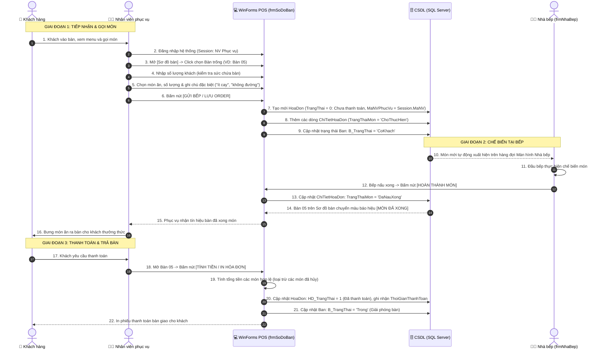

# QUY TRÌNH PHỤC VỤ & ORDER GỌI MÓN (RESTAURANT ORDER WORKFLOW)

**Dự án:** Hệ thống Quản lý Quán ăn (VB.NET WinForms + Microsoft SQL Server 2022)  
**Tài liệu tham chiếu:** [`KIEN_TRUC_HE_THONG.md`](KIEN_TRUC_HE_THONG.md), [`DATABASE_SCHEMA.md`](DATABASE_SCHEMA.md), [`MA_TRAN_PHAN_QUYEN.md`](MA_TRAN_PHAN_QUYEN.md)  
**Phân hệ liên quan:** `Features/BanAn_GoiMon/` & `Features/NhaBep/`

---

## 1. TỔNG QUAN & TÁC NHÂN NGHIỆP VỤ (ACTORS)

Trong hệ thống phần mềm quản lý quán ăn, **Khách hàng KHÔNG trực tiếp đăng nhập hay sử dụng phần mềm**. Tất cả các thao tác order, gửi bếp, thanh toán đều được thực hiện thông qua **Nhân viên phục vụ** (hoặc **Quản lý**) bằng máy trạm tại quầy hoặc máy tính bảng/POS:

- 👤 **Khách hàng:** Đến quán, ngồi vào bàn, xem thực đơn giấy/menu và trao đổi yêu cầu món ăn trực tiếp với nhân viên phục vụ.
- 🧑‍💼 **Nhân viên phục vụ:** Tiếp nhận yêu cầu, thao tác trên phần mềm (chọn bàn, nhập số lượng khách, chọn món, ghi chú "ít cay", "không đá", gửi lệnh xuống bếp, bưng món khi bếp xong).
- 👨‍🍳 **Nhà bếp / Pha chế:** Xem danh sách hàng đợi các món cần nấu theo thứ tự thời gian thực (FIFO), bấm xác nhận khi món nấu xong để phục vụ biết bưng lên bàn.
- 👔 **Quản lý:** Trong trường hợp quán đông khách, quản lý có thể order thay phục vụ, hệ thống cho phép chọn nhân viên phục vụ tương ứng để ghi nhận doanh số và chấm công.

---

## 2. SƠ ĐỒ TRÌNH TỰ ĐIỀU HÀNH (SEQUENCE DIAGRAM)

---

## 3. CHI TIẾT CÁC TÌNH HUỐNG NGHIỆP VỤ ĐẶC THÙ

### 3.1. Khách gọi thêm món (Add-on Order)
- Khách muốn gọi thêm đồ ăn hoặc nước ngọt trong khi đang ăn.
- **Thao tác:** Phục vụ click lại vào Bàn đang phục vụ $\rightarrow$ Bấm nút "Thêm món" $\rightarrow$ Chọn món mới và số lượng $\rightarrow$ Bấm "Gửi bếp".
- **Hệ thống:** Thêm các dòng `ChiTietHoaDon` mới vào hóa đơn hiện hữu của bàn đó mà không tạo hóa đơn mới.

### 3.2. Khách muốn Đổi món hoặc Hủy món
- **Quy tắc vàng:** Chỉ được phép đổi/hủy món khi món đó **Nhà bếp chưa chế biến xong** (`TrangThaiMon = 'ChoThucHien'`).
- Nếu bếp đã bấm *Đã nấu xong* $\rightarrow$ Hệ thống khóa nút Hủy/Đổi, thông báo: *"Món ăn đã được bếp nấu xong, không thể hủy!"*.
- Món hủy sẽ được đánh dấu `CTHD_Xoa = 1` hoặc `TrangThaiMon = 'DaHuy'` và không bị tính tiền vào tổng hóa đơn.

### 3.3. Khách muốn Chuyển bàn
- Khách đang ngồi Bàn 02 muốn chuyển sang Bàn 08 (rộng hơn hoặc gần cửa sổ).
- **Điều kiện:** Bàn 08 phải đang ở trạng thái **Trống**.
- **Xử lý:** Cập nhật `HD_MaBan` từ Bàn 02 sang Bàn 08; cập nhật trạng thái Bàn 02 về *Trống*, Bàn 08 thành *Có khách*. Các món đang chờ ở bếp tự động cập nhật số bàn mới.

### 3.4. Khách muốn Gộp bàn
- Hai nhóm khách đi chung ngồi ở Bàn 03 và Bàn 04 muốn tính chung tiền vào 1 hóa đơn.
- **Xử lý:** Gộp toàn bộ chi tiết hóa đơn của Bàn 04 vào Bàn 03; cập nhật hóa đơn Bàn 04 thành đã gộp; giải phóng Bàn 04 về trạng thái *Trống*.

### 3.5. Nghiệp vụ Quản lý Order thay Nhân viên phục vụ
- Khi quán đông khách đột xuất, **Quản lý** đăng nhập hệ thống để trực tiếp order giúp nhân viên.
- **Đặc điểm phần mềm:** Trên màn hình gọi món, hệ thống hiển thị thêm ComboBox: **"Nhân viên phục vụ phụ trách"**.
  - Quản lý chọn tên nhân viên phục vụ chịu trách nhiệm bàn đó.
  - CSDL lưu `HD_MaNVPhucVu = [Mã NV được chọn]` để cuối tháng lập báo cáo thống kê chính xác năng suất làm việc (số lượng khách đã phục vụ) cho nhân viên đó.

---

## 4. ÁNH XẠ DỮ LIỆU CSDL (DATABASE MAPPING)

| Thực thể CSDL | Bảng tương ứng | Các trường dữ liệu cốt lõi | Ý nghĩa nghiệp vụ |
| :--- | :--- | :--- | :--- |
| **Bàn ăn** | `Ban` | `B_Ma`, `B_TenBan`, `B_SoNguoiToiDa`, `B_TrangThai` | Quản lý trạng thái trực quan: *Trống, Có khách, Đang chờ món, Món đã xong*. |
| **Hóa đơn** | `HoaDon` | `HD_Ma`, `HD_MaBan`, `HD_MaNVPhucVu`, `HD_SoLuongKhach`, `HD_ThoiGianVao`, `HD_TongTien`, `HD_TrangThai` | Lưu thông tin phiên ăn uống của một bàn từ lúc vào đến khi thanh toán. |
| **Chi tiết món**| `ChiTietHoaDon` | `CTHD_Ma`, `CTHD_MaHoaDon`, `CTHD_MaMonAn`, `CTHD_SoLuong`, `CTHD_DonGia`, `CTHD_GhiChu`, `CTHD_TrangThaiMon` | Quản lý từng món được gọi, ghi chú chế biến và tiến độ hoàn thành của bếp. |
| **Thực đơn** | `MonAn` | `MA_Ma`, `MA_Ten`, `MA_DonGia`, `MA_HetMon` | Kiểm tra tình trạng món còn hay hết hàng (`MA_HetMon = 1`) để cảnh báo phục vụ ngay khi gọi món. |

---

## 5. KẾ HOẠCH TRIỂN KHAI PHẦN MỀM

Quy trình này sẽ được mã hóa hoàn chỉnh trong phân hệ **`Features/BanAn_GoiMon`** bao gồm:
1. `frmSoDoBan.vb`: Hiển thị lưới sơ đồ các bàn ăn theo màu sắc trạng thái.
2. `frmGoiMon.vb`: Giao diện chọn món, chọn danh mục, nhập số lượng, ghi chú và gửi lệnh xuống bếp.
3. `frmThanhToan.vb`: Xác nhận hóa đơn, chọn hình thức thanh toán (Tiền mặt / Chuyển khoản / QR Code) và xuất phiếu in.
