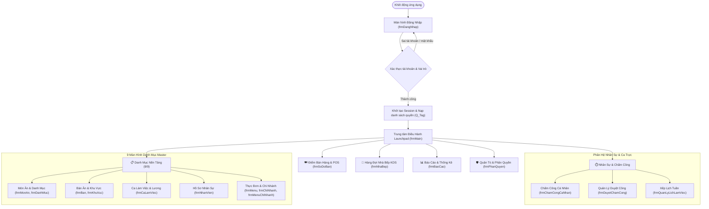
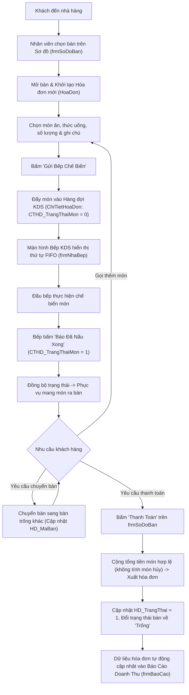
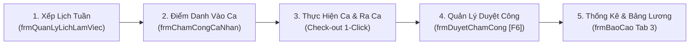
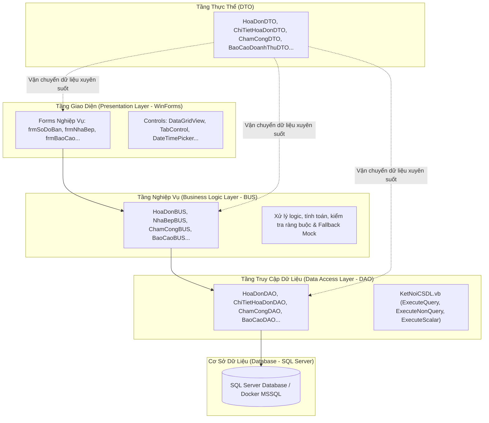

# Sơ Đồ Luồng Hoạt Động Hệ Thống (Application Flowcharts)
**Dự án:** Hệ Thống Quản Lý Quán Ăn & Chuỗi Nhà Hàng — Phúc Lộc Thọ  
**Công nghệ:** VB.NET WinForms (.NET 10.0) + SQL Server + Kiến trúc 3 Lớp

---

## 1. Sơ Đồ Luồng Tổng Thể Hệ Thống (Master System Flow)

---

## 2. Sơ Đồ Chu Trình Bán Hàng, Chế Biến & Thanh Toán (POS & Kitchen Flow)

---

## 3. Sơ Đồ Chu Trình Quản Trị Nhân Sự, Chấm Công & Tính Lương (Staff Lifecycle)

---

## 4. Sơ Đồ Kiến Trúc Phân Tầng Dữ Liệu 3 Lớp (3-Tier Architecture)

