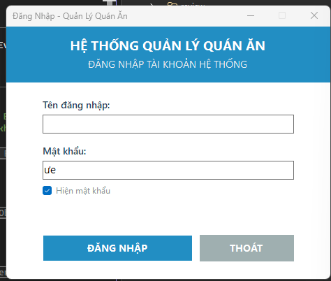

# TÀI LIỆU KỸ THUẬT: CẤU TRÚC GIAO DIỆN & VÒNG ĐỜI FORM ĐĂNG NHẬP (`frmDangNhap`)

**Dự án:** Hệ thống Quản lý Quán ăn (VB.NET Windows Forms - .NET 10.0)  
**Màn hình:** `Features/Auth/frmDangNhap`  
**Tài liệu liên quan:** [`AUTH_DANG_NHAP.md`](AUTH_DANG_NHAP.md) & [`KIEN_TRUC_HE_THONG.md`](../KIEN_TRUC_HE_THONG.md)  

---

## 1. HÌNH ẢNH GIAO DIỆN CHẠY THỰC TẾ



---

## 2. BÓC TÁCH CHI TIẾT TỪNG THÀNH PHẦN GIAO DIỆN (UI COMPONENTS)

Toàn bộ các control hiển thị trên màn hình đều được định nghĩa chi tiết trong file [`frmDangNhap.Designer.vb`](../../Quanlyquanan/Features/Auth/frmDangNhap.Designer.vb):

```
┌────────────────────────────────────────────────────────┐
│  Đăng Nhập - Quản Lý Quán Ăn              ─   □   ✕   │  <-- 1. Khung Form chính
├────────────────────────────────────────────────────────┤
│             HỆ THỐNG QUẢN LÝ QUÁN ĂN                  │  <-- 2. Header Panel (Màu xanh)
│           ĐĂNG NHẬP TÀI KHOẢN HỆ THỐNG                 │
├────────────────────────────────────────────────────────┤
│  Tên đăng nhập:                                        │  <-- 3. Vùng nhập liệu
│  ┌──────────────────────────────────────────────────┐  │
│  └──────────────────────────────────────────────────┘  │
│  Mật khẩu:                                             │
│  ┌──────────────────────────────────────────────────┐  │
│  │ ue                                               │  │
│  └──────────────────────────────────────────────────┘  │
│  ☑ Hiện mật khẩu                                       │  <-- 4. Checkbox
│  [Vùng nhãn đỏ ẩn sẵn hiển thị thông báo lỗi]         │  <-- 5. Nhãn thông báo
│                                                        │
│  ┌───────────────────────┐   ┌──────────────────────┐  │  <-- 6. Hai nút bấm
│  │       ĐĂNG NHẬP       │   │        THOÁT         │  │
│  └───────────────────────┘   └──────────────────────┘  │
└────────────────────────────────────────────────────────┘
```

### 2.1. Cấu hình Khung Cửa Sổ Form Chính
- **`Text = "Đăng Nhập - Quản Lý Quán Ăn"`**: Chuỗi tiêu đề hiển thị trên thanh taskbar của Windows và góc trên bên trái cửa sổ.
- **`ClientSize = New Size(464, 361)`**: Kích thước vùng hiển thị là chiều rộng 464px, chiều cao 361px.
- **`StartPosition = FormStartPosition.CenterScreen`**: Cửa sổ tự động rơi vào chính giữa màn hình máy tính khi mở.
- **`FormBorderStyle = FormBorderStyle.FixedDialog`**: Cố định viền cửa sổ, **không cho kéo dãn mép** nhằm bảo toàn bố cục không bị xô lệch.
- **`MaximizeBox = False`**: Vô hiệu hóa nút phóng to toàn màn hình.

### 2.2. Dải Header Màu Xanh Đại Dương (`pnlHeader`)
- Là một `Panel` dính chặt đỉnh Form (`Dock = DockStyle.Top`) với chiều cao `Height = 80`.
- Màu nền hiện đại: `BackColor = Color.FromArgb(41, 128, 185)` (Màu xanh phẳng Flat Blue).
- Bên trong chứa 2 Label căn giữa:
  - `lblTieuDeChinh`: Font 14 Bold, chữ màu trắng: *"HỆ THỐNG QUẢN LÝ QUÁN ĂN"*.
  - `lblTieuDePhu`: Font 10 Regular, màu xám trắng: *"ĐĂNG NHẬP TÀI KHOẢN HỆ THỐNG"*.

### 2.3. Vùng Nhập Liệu & Nhãn (`TextBox` & `Label`)
- Cả 2 ô nhập đều bắt đầu từ trục hoành **`X = 52`** với chiều rộng `Width = 360` tạo thành đường gióng thẳng tắp:
  - `txtTenDangNhap`: `Location = Point(52, 126)`, giới hạn tối đa 50 ký tự (`MaxLength = 50`).
  - `txtMatKhau`: `Location = Point(52, 192)`, mặc định kích hoạt `UseSystemPasswordChar = True` để Windows tự chuyển ký tự thành dấu chấm tròn `●●●●●`.

### 2.4. Checkbox Xem Mật Khẩu (`chkHienMatKhau`)
- `Location = Point(52, 226)`.
- Khi người dùng nhấp chọn, sự kiện `chkHienMatKhau_CheckedChanged` sẽ đổi `UseSystemPasswordChar = Not chkHienMatKhau.Checked`, cho phép chuyển đổi tức thì giữa chế độ bảo mật và văn bản rõ.

### 2.5. Vùng Thông Báo Lỗi (`lblThongBaoLoi`)
- `Location = Point(52, 252)`, `ForeColor = Color.FromArgb(231, 76, 60)` (Màu đỏ cảnh báo).
- Ban đầu là chuỗi rỗng (`String.Empty`). Chỉ khi người dùng bấm đăng nhập mà để trống hoặc nhập sai, chuỗi lỗi mới được nạp vào.

### 2.6. Hai Nút Bấm Phẳng (`btnDangNhap` & `btnThoat`)
- Thiết kế theo phong cách phẳng: `FlatStyle = FlatStyle.Flat` và `FlatAppearance.BorderSize = 0` (loại bỏ viền nổi 3D cổ điển).
- `btnDangNhap`: Màu xanh đại dương (`#2980B9`), chữ trắng, kích thước (215 x 38).
- `btnThoat`: Màu xám thanh lịch (`#95A5A6`), chữ trắng, kích thước (135 x 38).

### 2.7. Tối Ưu Trải Nghiệm Người Dùng (UX & Phím Tắt)
- **`Me.AcceptButton = Me.btnDangNhap`**: Người dùng đang ở bất kỳ ô nhập nào mà bấm phím **Enter**, hệ thống tự động kích hoạt nút Đăng Nhập.
- **`Me.CancelButton = Me.btnThoat`**: Người dùng nhấn phím **ESC**, hệ thống tự động kích hoạt nút Thoát.
- **Sự kiện `txtTenDangNhap_KeyDown`**: Khi gõ xong tên đăng nhập và nhấn **Enter**, con trỏ chuột tự động nhảy xuống ô Mật khẩu.
- **Sự kiện `txtInputs_TextChanged`**: Tự động xóa thông báo lỗi khi người dùng bắt đầu nhập lại chữ mới.

---

## 3. VÒNG ĐỜI CHI TIẾT (LIFECYCLE) CỦA FORM TỪ KHI BẬT ĐẾN KHI TẮT

Trong nền tảng Windows Forms, mỗi Form là một lớp kế thừa từ `System.Windows.Forms.Form`. Vòng đời của nó trải qua **4 giai đoạn tuần tự**:

```
[Bấm F5 / Khởi chạy ứng dụng]
         │
         ▼
 1. Sub New()                 --> Cấp phát bộ nhớ đối tượng
         │
         ▼
 2. InitializeComponent()     --> Vẽ các Control (Button, Textbox, Panel...)
         │
         ▼
 3. frmDangNhap_Load          --> Chuẩn bị logic trước khi lên hình (Reset lỗi, Focus)
         │
         ▼
 4. Form_Shown                --> Form chính thức hiển thị trước mắt người dùng
         │
         ▼
 5. Vòng lặp sự kiện          --> Lắng nghe gõ phím, click chuột, gọi AuthBUS
    (Message Loop)
         │
         ▼
 6. FormClosing               --> Hỏi xác nhận thoát (Yes / No)
         │
         ▼
 7. FormClosed & Dispose()    --> Đóng cửa sổ & giải phóng toàn bộ RAM, bộ nhớ đồ họa
```

### Giai đoạn 1: Khởi Tạo Bộ Nhớ (Instantiation & Initialization)
1. Khi ứng dụng khởi động từ file `Application.Designer.vb`:
   ```vbnet
   Me.MainForm = New Global.Quanlyquanan.Features.Auth.frmDangNhap()
   ```
2. Hàm khởi tạo `Sub New()` trong `frmDangNhap.vb` được thực thi.
3. Câu lệnh đầu tiên được gọi là `InitializeComponent()` trong file `frmDangNhap.Designer.vb`. Phương thức này khởi tạo lần lượt các đối tượng `Panel`, `Label`, `TextBox`, `Button`, thiết lập màu sắc, tọa độ X/Y, font chữ và thêm vào cây giao diện thông qua `Me.Controls.Add()`.

### Giai đoạn 2: Nạp Dữ Liệu & Hiển Thị (Loading & Rendering)
4. Sự kiện **`frmDangNhap_Load`** kích hoạt: Chạy code chuẩn bị ngay trước khi Form xuất hiện:
   ```vbnet
   lblThongBaoLoi.Text = String.Empty  ' Xóa sạch nhãn lỗi cũ
   txtTenDangNhap.Focus()               ' Tự động đưa con trỏ nhấp nháy vào ô đầu tiên
   ```
5. Sự kiện **`Form_Shown`**: Form hoàn tất vẽ toàn bộ pixel lên màn hình và sẵn sàng đón nhận tương tác từ người dùng.

### Giai đoạn 3: Vòng Lặp Lắng Nghe Sự Kiện (Event Handling Loop)
Sau khi hiển thị, Form vận hành trong một vòng lặp sự kiện (`Windows Message Loop`) để đón các hành vi:
- **Người dùng gõ chữ:** Kích hoạt `TextChanged` $\rightarrow$ Tự động xóa thông báo lỗi.
- **Người dùng nhấn Enter ở ô tài khoản:** Kích hoạt `KeyDown` $\rightarrow$ Nhảy con trỏ xuống ô mật khẩu.
- **Người dùng tick checkbox:** Kích hoạt `CheckedChanged` $\rightarrow$ Chuyển đổi trạng thái `UseSystemPasswordChar`.
- **Người dùng bấm nút Đăng Nhập:** Kích hoạt `btnDangNhap_Click`:
  1. Tạm thời khóa nút bấm (`Enabled = False`) và đổi con trỏ chuột sang hình đồng hồ cát (`Cursors.WaitCursor`) chống spam click.
  2. Chuyển dữ liệu sang lớp `AuthBUS.DangNhap(tenDangNhap, matKhau, thongBaoLoi)`.
  3. Nếu thành công: Mở `Form1` và gọi `Me.Hide()` để ẩn Form đăng nhập.
  4. Nếu thất bại: Hiển thị lỗi đỏ trên `lblThongBaoLoi`, tự động bôi đen toàn bộ ô mật khẩu (`SelectAll()`) để người dùng gõ lại ngay.

### Giai đoạn 4: Đóng & Giải Phóng Tài Nguyên (Closing & Disposal)
- Khi người dùng bấm nút **THOÁT** hoặc nút `✕` góc trên cùng bên phải:
  1. Hộp thoại xác nhận `MessageBox.Show` bật lên hỏi: *"Bạn có chắc chắn muốn thoát khỏi ứng dụng không?"*.
  2. Nếu người dùng chọn `No`: Hủy thao tác đóng, Form tiếp tục chạy bình thường.
  3. Nếu người dùng chọn `Yes`: Hệ thống kích hoạt `Application.Exit()`.
  4. Sự kiện `FormClosed` kích hoạt, sau đó phương thức `Dispose(disposing As Boolean)` dọn dẹp các tài nguyên đồ họa (GDI+ brushes, fonts, window handles) và trả toàn bộ bộ nhớ RAM về cho hệ điều hành Windows.
