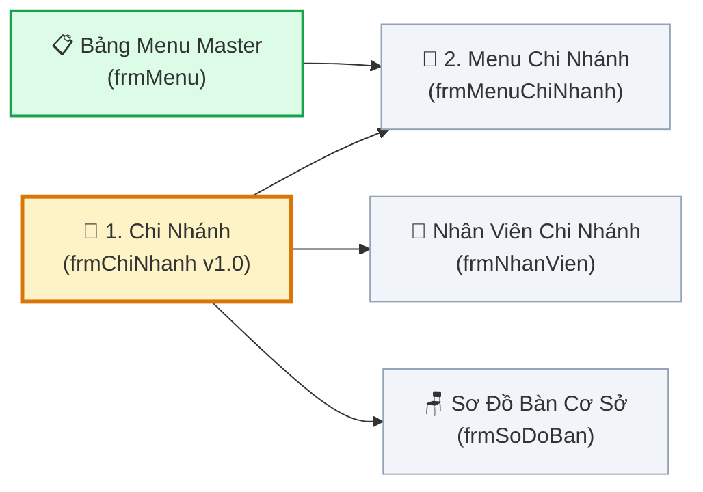

# KẾ HOẠCH SPRINT — MÀN HÌNH 8/9: QUẢN LÝ CHI NHÁNH CHUỖI NHÀ HÀNG (`frmChiNhanh v1.0`)

**Dự án:** Hệ thống Quản lý Quán ăn (`Quanlyquanan`)  
**Phân hệ:** Quản trị Chuỗi & Cơ sở (`Features/Branch/`)  
**Công nghệ:** VB.NET Windows Forms (.NET 10.0-windows) + Microsoft SQL Server 2022 Express (Docker)  
**Tài liệu liên quan:**
- [`docs/CHECKLIST_UU_TIEN_DANH_MUC.md`](../../../docs/CHECKLIST_UU_TIEN_DANH_MUC.md) *(Màn hình 8 / 9)*
- [`docs/CHECKLIST_DO_AN.md`](../../../docs/CHECKLIST_DO_AN.md) *(Mục 3.5)*
- Mockup HTML: [`frmChiNhanh_mockup_v1_0.html`](frmChiNhanh_mockup_v1_0.html)
- Interactive Master Hub: [`docs/demo_system.html`](../../../docs/demo_system.html)

---

## 1. TỔNG QUAN VÀ BẢN CHẤT NGHIỆP VỤ CỦA MÀN HÌNH `frmChiNhanh`

Trong mô hình chuỗi quán ăn đa chi nhánh (tương tự như bài giảng của giảng viên trong video và chuẩn quản trị F&B ERP):

* **`ChiNhanh` (Màn hình 8):** Quản lý hồ sơ pháp lý và vận hành của từng cơ sở trực thuộc chuỗi nhà hàng (Tên chi nhánh, Địa chỉ, Hotline, Quản lý phụ trách cơ sở, Sức chứa chỗ ngồi tối đa, Khung giờ mở cửa, Trạng thái hoạt động).
* **Liên kết dữ liệu:**
  * `NhanVien`: Quản lý phụ trách chi nhánh (`CN_NguoiQuanLy` trỏ tới `NhanVien.NV_Ma`).
  * `ChiNhanh_Menu`: Màn hình 9 sẽ phân bổ các bảng thực đơn cho từng cơ sở.
  * `Ban` & `HoaDon`: Gắn liền với cơ sở kinh doanh để tính doanh thu theo từng chi nhánh.

---

## 2. CƠ SỞ DỮ LIỆU & SCHEMA SPECIFICATION

### Cấu trúc Bảng `ChiNhanh`
| Cột | Kiểu dữ liệu | Ràng buộc | Diễn giải |
| :--- | :--- | :--- | :--- |
| `CN_Ma` | `INT IDENTITY(1,1)` | `PRIMARY KEY` | Mã định danh chi nhánh |
| `CN_Ten` | `NVARCHAR(100)` | `NOT NULL` | Tên chi nhánh (VD: Chi nhánh 1 - Quận 1) |
| `CN_DiaChi` | `NVARCHAR(255)` | `NOT NULL` | Địa chỉ cơ sở |
| `CN_SoDienThoai` | `NVARCHAR(20)` | `NULL` | Số điện thoại hotline cơ sở |
| `CN_NguoiQuanLy` | `INT` | `FK NhanVien(NV_Ma)` | Quản lý phụ trách chi nhánh |
| `CN_SucChua` | `INT` | `DEFAULT 50, CHECK > 0` | Tổng sức chứa khách tối đa |
| `CN_GioMoCua` | `NVARCHAR(50)` | `DEFAULT N'07:00 - 22:00'` | Khung giờ hoạt động hàng ngày |
| `CN_MoTa` | `NVARCHAR(255)` | `NULL` | Ghi chú mặt bằng, tiện ích |
| `CN_TrangThai` | `NVARCHAR(30)` | `DEFAULT N'Đang mở cửa'` | `Đang mở cửa`, `Tạm đóng cửa`, `Đang sửa chữa` |
| `CN_Xoa` | `BIT` | `DEFAULT 0` | Cờ xóa mềm (0: Hoạt động, 1: Đã xóa) |

---

## 3. THIẾT KẾ GIAO DIỆN & TRẢI NGHIỆM NGƯỜI DÙNG (UI/UX SPEC)

* **Bố cục:** Split-Layout 38% : 62% nhất quán toàn hệ thống.
  * **Cột trái (38%):** Form nhập liệu chi nhánh (Mã, Tên, Địa chỉ, SĐT, Người quản lý, Sức chứa, Giờ mở cửa, Trạng thái, Ghi chú) + Cụm nút CRUD chuẩn (`Thêm`, `Lưu`, `Xóa`, `Làm mới`, `Đóng`).
  * **Cột phải (62%):** Bảng dữ liệu DataGridView hiển thị danh sách chi nhánh, kèm thanh tìm kiếm tức thì theo Tên/Địa chỉ/SĐT và bộ lọc ComboBox theo Trạng thái hoạt động.
* **Màu sắc chỉ báo trực quan:**
  * `Đang mở cửa`: Tag xanh lá `#16a34a`.
  * `Tạm đóng cửa`: Tag vàng cam `#d97706`.
  * `Đang sửa chữa`: Tag xám/đỏ `#dc2626`.

---

## 4. QUY TẮC RÀNG BUỘC NGHIỆP VỤ (BUSINESS RULES)

1. **Ràng buộc trường bắt buộc:** Tên chi nhánh và Địa chỉ không được để trống.
2. **Sức chứa:** Phải là số nguyên dương $> 0$.
3. **Số điện thoại:** Nếu nhập thì phải đúng định dạng 10 số di động Việt Nam.
4. **Kiểm tra trùng lặp:** Không cho phép tạo 2 chi nhánh trùng tên hoặc trùng địa chỉ.
5. **Bảo vệ toàn vẹn dữ liệu khi xóa:** Không được xóa chi nhánh nếu đang có bàn hoặc đơn hàng hoạt động liên kết. Thực hiện xóa mềm (`CN_Xoa = 1`).
6. **Phân quyền RBAC:** Yêu cầu quyền `CQ_QUAN_LY_CHI_NHANH` (chỉ Chủ quán và cấp quản lý được phân quyền mới có quyền Thêm/Sửa/Xóa).

---

## 5. KẾT QUẢ KIỂM THỬ TỰ ĐỘNG (AUTOMATED TEST MATRIX)

* **Tổng số bài test:** 39 test cases
* **Kết quả:** **39 / 39 PASS (100%)**
  - Nhóm 1 (Code Quality Rules - Hàm <= 40 dòng, File <= 500 dòng): 10/10 PASS
  - Nhóm 2 (Controls & WinForms Designer): 19/19 PASS
  - Nhóm 3 (Validation & Business Rules): 6/6 PASS
  - Nhóm 4 (Integration frmMain & RBAC): 4/4 PASS
