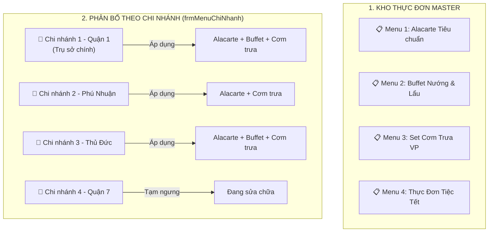

# KẾ HOẠCH SPRINT — MÀN HÌNH 9/9: PHÂN BỔ THỰC ĐƠN THEO CHI NHÁNH (`frmMenuChiNhanh v1.0`)

**Dự án:** Hệ thống Quản lý Quán ăn (`Quanlyquanan`)  
**Phân hệ:** Quản trị Chuỗi & Thực Đơn Cơ Sở (`Features/Branch/`)  
**Công nghệ:** VB.NET Windows Forms (.NET 10.0-windows) + Microsoft SQL Server 2022 Express (Docker)  
**Tài liệu liên quan:**
- [`docs/CHECKLIST_UU_TIEN_DANH_MUC.md`](../../../docs/CHECKLIST_UU_TIEN_DANH_MUC.md) *(Màn hình 9 / 9 — Màn hình cuối cùng hoàn tất 100% Master Data)*
- [`docs/CHECKLIST_DO_AN.md`](../../../docs/CHECKLIST_DO_AN.md) *(Mục 3.5)*
- Mockup HTML: [`frmMenuChiNhanh_mockup_v1_0.html`](frmMenuChiNhanh_mockup_v1_0.html)
- Interactive Master Hub: [`docs/demo_system.html`](../../../docs/demo_system.html)

---

## 1. TỔNG QUAN VÀ BẢN CHẤT NGHIỆP VỤ CỦA MÀN HÌNH `frmMenuChiNhanh`

Trong mô hình chuỗi quán ăn đa chi nhánh (bám sát bài giảng thực hành của giảng viên trong video và chuẩn quản trị F&B ERP):

* **Vai trò:** Mỗi cơ sở có mặt bằng, đối tượng khách hàng và năng lực phục vụ khác nhau. Màn hình `frmMenuChiNhanh` cho phép Chủ quán và Quản lý cơ sở:
  1. Chọn Chi nhánh ➔ Xem danh sách các Bảng thực đơn (`Menu`) đang được bán tại cơ sở.
  2. Gán thêm Menu mới vào Chi nhánh kèm ngày bắt đầu và ghi chú áp dụng.
  3. Bật/Tắt nhanh trạng thái áp dụng (`Đang áp dụng` &harr; `Tạm ngưng`) theo mùa vụ hoặc sự kiện.
  4. Gỡ bỏ Menu khỏi Chi nhánh khi không còn kinh doanh tại địa điểm đó.

---

## 2. CƠ SỞ DỮ LIỆU & SCHEMA SPECIFICATION

### Cấu trúc Bảng `ChiNhanh_Menu`
| Cột | Kiểu dữ liệu | Ràng buộc | Diễn giải |
| :--- | :--- | :--- | :--- |
| `CNM_Ma` | `INT IDENTITY(1,1)` | `PRIMARY KEY` | Mã định danh dòng phân bổ |
| `CNM_MaChiNhanh` | `INT` | `FK ChiNhanh(CN_Ma)` | Chi nhánh áp dụng |
| `CNM_MaMenu` | `INT` | `FK Menu(MN_Ma)` | Bảng thực đơn được áp dụng |
| `CNM_NgayBatDau` | `DATE` | `DEFAULT GETDATE()` | Ngày bắt đầu có hiệu lực tại cơ sở |
| `CNM_NgayKetThuc` | `DATE` | `NULL` | Ngày kết thúc hiệu lực (nếu có) |
| `CNM_GhiChu` | `NVARCHAR(255)` | `NULL` | Ghi chú áp dụng theo cơ sở |
| `CNM_TrangThai` | `NVARCHAR(30)` | `DEFAULT N'Đang áp dụng'` | `Đang áp dụng`, `Tạm ngưng` |
| `CNM_Xoa` | `BIT` | `DEFAULT 0` | Cờ xóa mềm (0: Hoạt động, 1: Đã xóa) |
| `UQ_ChiNhanh_Menu`| `UNIQUE` | `(CNM_MaChiNhanh, CNM_MaMenu)` | Không gán trùng 1 Menu 2 lần vào 1 CN |

---

## 3. THIẾT KẾ GIAO DIỆN & TRẢI NGHIỆM NGƯỜI DÙNG (UI/UX SPEC)

* **Bố cục Master-Detail:**
  * **Thanh chọn cơ sở (Header Panel):** ComboBox chọn Chi nhánh trực quan kèm hiển thị nhanh thông tin địa chỉ và sức chứa.
  * **Cột trái (40%):** Form gán / cập nhật Menu cho chi nhánh (chọn Menu từ kho, ngày bắt đầu, ngày kết thúc, trạng thái, ghi chú) + Các nút thao tác (`Gán Menu`, `Lưu`, `Gỡ Menu`, `Làm mới`).
  * **Cột phải (60%):** Bảng DataGridView hiển thị danh sách các Menu đang bán tại cơ sở đó, kèm thanh tìm kiếm và bộ lọc trạng thái.

---

## 4. QUY TẮC RÀNG BUỘC NGHIỆP VỤ (BUSINESS RULES)

1. **Ràng buộc chi nhánh & Menu:** Phải chọn Chi nhánh và Menu hợp lệ trước khi gán.
2. **Chống gán trùng:** Không cho phép gán trùng một Menu đã có sẵn trong chi nhánh (nếu đã có thì báo lỗi hoặc yêu cầu cập nhật).
3. **Ngày hiệu lực:** Ngày kết thúc (nếu nhập) phải lớn hơn hoặc bằng Ngày bắt đầu.
4. **Phân quyền RBAC:** Yêu cầu quyền `CQ_QUAN_LY_THUC_DON` (quyền quản lý thực đơn toàn hệ thống).
5. **Clean Code Rule:** 100% hàm &le; 40 dòng, 100% file &le; 500 dòng.

---

## 5. TIẾN ĐỘ THỰC HIỆN 5 BƯỚC

- [x] **Bước 1 (v0.2.11 - CSDL & Đặc tả):** CSDL bảng `ChiNhanh_Menu`, seed data, tài liệu `MENU_CHI_NHANH_SPRINT.md`, mockup HTML tương tác `frmMenuChiNhanh_mockup_v1_0.html`. *(Commit `2fbf01e`)*
- [x] **Bước 2 (v0.2.11 - Thiết kế WinForms Designer):** Tạo giao diện `frmMenuChiNhanh.Designer.vb` (306 dòng, hàm <= 40 dòng). *(Commit `516a0c2`)*
- [x] **Bước 3 (v0.2.11 - DTO/DAO/BUS & Code-behind):** Tạo `ChiNhanhMenuDTO.vb` (53 dòng), `ChiNhanhMenuDAO.vb` (186 dòng), `ChiNhanhMenuBUS.vb` (97 dòng), `frmMenuChiNhanh.vb` (273 dòng). *(Commit `d7b2f4e`)*
- [x] **Bước 4 (v0.2.11 - Tích hợp frmMain & Kiểm thử tự động):** Tích hợp `frmMain.vb` (hàm `MoQuanLyMenuChiNhanh()`), kịch bản kiểm thử `scratch/MenuChiNhanhVerifier.ps1` **44/44 PASS (100%)**.
- [ ] **Bước 5 (v0.2.11 - Release Report & Git Tag):** Báo cáo phát hành `report_0_2_11.html`, đồng bộ 2 checklist, gắn Git Tag `v0.2.11`.
