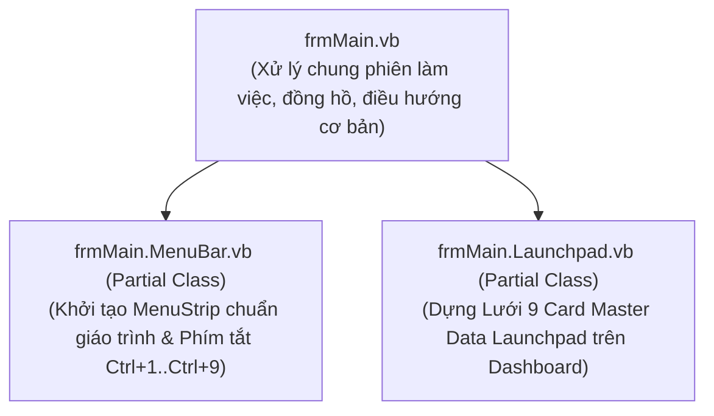

# KẾ HOẠCH SPRINT: TÍCH HỢP TRUNG TÂM DANH MỤC MASTER DATA TRÊN `frmMain` (v1.2)
## "NHÌN VÀO THẤY NGAY 100% THÀNH QUẢ 9 MÀN HÌNH DANH MỤC"

**Dự án:** Hệ thống Quản lý Quán ăn (`Quanlyquanan`)  
**Mục tiêu Sprint:** Trực quan hóa toàn bộ 9/9 Màn hình Danh mục Nền tảng (Master Data) đã hoàn thành ngay tại giao diện chính (`frmMain`), giúp người chấm điểm / giảng viên nhận biết tức thì quy mô hệ thống mà không cần đào sâu qua nhiều bước thao tác.  
**Phiên bản đích:** `v0.2.12`  

---

## 1. BỐI CẢNH & VẤN ĐỀ CẦN GIẢI QUYẾT

* **Thực trạng trước đó:**
  * Hệ thống đã hoàn thành trọn vẹn 9 màn hình danh mục chuyên sâu (Nhân viên, Ca làm việc, Món ăn, Danh mục món, Khu vực, Bàn ăn, Bảng thực đơn, Chi nhánh, Menu chi nhánh).
  * Tuy nhiên trên `frmMain`, một số màn hình bị "giấu" sâu bên trong các form khác hoặc gọi gián tiếp qua nút CTA (ví dụ: `frmKhuVuc` nằm trong `frmBan`, `frmDanhMuc` nằm trong `frmMonAn`, `frmChiNhanh` và `frmMenuChiNhanh` chưa có nút trực tiếp trên Dashboard).
  * Người chấm điểm khi đăng nhập vào hệ thống chỉ nhìn thấy 4-5 nút cơ bản, dễ dẫn đến nhận định sai lệch rằng dự án thiếu màn hình.

* **Giải pháp phối hợp (Kết hợp Phương án 1 và Phương án 2):**
  1. **Thanh Menu Cấp Cao (`MenuStrip`):** Bổ sung thanh menu chuẩn giáo trình môn học (bám sát cấu trúc bài giảng video của Thầy Trương Phước Lộc) trên đỉnh form. Trong đó, menu `📋 Danh Mục Nền Tảng (Master Data)` xổ xuống liệt kê đầy đủ 9 màn hình kèm phím tắt từ `Ctrl+1` đến `Ctrl+9`.
  2. **Trung Tâm Launchpad Dashboard (Lưới 3x3 Cards Trực Quan):** Khu vực trung tâm của Dashboard được trang bị bản đồ 9 Card Tiles nổi bật đại diện cho 9 màn hình. Giảng viên mở ứng dụng là thấy ngay 9 ô thẻ đầy màu sắc với dữ liệu thực tế và nút mở trực tiếp 1-Click.

---

## 2. KIẾN TRÚC GIAO DIỆN & TỔ CHỨC MÃ NGUỒN (CLEAN CODE RULES)

Nhằm đảm bảo quy tắc **File ≤ 500 dòng** và **Hàm ≤ 40 dòng**, giải pháp áp dụng `Partial Class frmMain`:

* **Ưu điểm kiến trúc:**
  - `frmMain.vb` không bị phình to (giữ nguyên < 400 dòng).
  - `frmMain.MenuBar.vb`: Khoảng 160 dòng, tách bạch hoàn toàn logic menu bar.
  - `frmMain.Launchpad.vb`: Khoảng 220 dòng, tách bạch hoàn toàn logic render thẻ card và nạp số liệu từ Database.
  - 100% hàm/thủ tục &le; 40 dòng.

---

## 3. DANH SÁCH 9 MÀN HÌNH TRÊN MASTER DATA LAUNCHPAD

| STT | Tên Danh Mục | Form Class | Icon | Phím Tắt | Quyền RBAC | Dữ Liệu Tóm Tắt |
| :-: | :--- | :--- | :-: | :-: | :--- | :--- |
| **1** | Nhân Viên & Tài Khoản | `Features.Staff.frmNhanVien` | 👥 | `Ctrl+1` | `CQ_QUAN_LY_NHAN_SU` | 15 Nhân sự • 4 Vai trò |
| **2** | Ca Làm Việc & Lương | `Features.Shift.frmCaLamViec` | ⏰ | `Ctrl+2` | `CQ_XEP_LICH_LAM_VIEC` | 4 Ca làm việc • Lương ca |
| **3** | Danh Mục Món Ăn & Giá | `Features.Menu.frmMonAn` | 🍲 | `Ctrl+3` | `CQ_QUAN_LY_THUC_DON` | 100+ Món ăn • Bật/tắt hết món |
| **4** | Phân Loại Nhóm Món | `Features.Menu.frmDanhMuc` | 📁 | `Ctrl+4` | `CQ_QUAN_LY_THUC_DON` | 6 Phân loại món ẩm thực |
| **5** | Khu Vực Bàn Ăn | `Features.Table.frmKhuVuc` | 🏢 | `Ctrl+5` | `CQ_QUAN_LY_BAN` | Sảnh trệt, VIP, Sân vườn |
| **6** | Sơ Đồ Bàn Ăn | `Features.Table.frmBan` | 🪑 | `Ctrl+6` | `CQ_QUAN_LY_BAN` | 12 Bàn ăn • 72 Chỗ ngồi |
| **7** | Bảng Thực Đơn Kinh Doanh | `Features.Menu.frmMenu` | 📋 | `Ctrl+7` | `CQ_QUAN_LY_THUC_DON` | Alacarte, Buffet, Set cơm |
| **8** | Chuỗi Cơ Sở Chi Nhánh | `Features.Branch.frmChiNhanh` | 🏬 | `Ctrl+8` | `CQ_QUAN_LY_CHI_NHANH` | 4 Chi nhánh chuỗi quán |
| **9** | Phân Bổ Menu Chi Nhánh | `Features.Branch.frmMenuChiNhanh` | 📑 | `Ctrl+9` | `CQ_QUAN_LY_THUC_DON` | Phân bổ menu theo cơ sở |

---

## 4. TIẾN ĐỘ THỰC HIỆN 5 BƯỚC

- [x] **Bước 1:** Đặc tả nghiệp vụ `MAIN_LAUNCHPAD_SPRINT.md` & Thiết kế Interactive Mockup HTML. *(Commit `fad8ce9`)*
- [x] **Bước 2:** Xây dựng `frmMain.MenuBar.vb` (MenuStrip cấp cao + Phím tắt) & `frmMain.Launchpad.vb` (Lưới 3x3 Cards). *(Commit `479e183`)*
- [x] **Bước 3:** Tích hợp gọi 9 hàm mở form, nạp số liệu tóm tắt từ CSDL & Phân quyền RBAC. *(Commit `3b10d06`)*
- [x] **Bước 4:** Xây dựng kịch bản kiểm thử tự động `MasterDataHubVerifier.ps1` **40/40 PASS (100%)**.
- [ ] **Bước 5:** Báo cáo phát hành `report_0_2_12.html` & Đồng bộ checklist.
