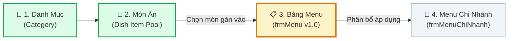

# KẾ HOẠCH SPRINT — MÀN HÌNH 7/9: BẢNG THỰC ĐƠN KINH DOANH (`frmMenu v1.0`)

**Dự án:** Hệ thống Quản lý Quán ăn (`Quanlyquanan`)  
**Phân hệ:** Quản lý Thực đơn & Chuỗi Chi nhánh (`Features/Menu/Catalog/`)  
**Công nghệ:** VB.NET Windows Forms (.NET 10.0-windows) + Microsoft SQL Server 2022 Express (Docker)  
**Tài liệu liên quan:**
- [`docs/CHECKLIST_UU_TIEN_DANH_MUC.md`](../../../docs/CHECKLIST_UU_TIEN_DANH_MUC.md) *(Màn hình 7 / 9)*
- [`docs/CHECKLIST_DO_AN.md`](../../../docs/CHECKLIST_DO_AN.md) *(Mục 3.5)*
- Mockup HTML: [`frmMenu_mockup_v1_0.html`](frmMenu_mockup_v1_0.html)
- Interactive Master Hub: [`docs/demo_system.html`](../../../docs/demo_system.html)

---

## 1. TỔNG QUAN VÀ BẢN CHẤT NGHIỆP VỤ CỦA MÀN HÌNH `frmMenu`

Trong mô hình F&B chuyên nghiệp và quản trị chuỗi nhà hàng (như Golden Gate, RedSun, iPOS, CukCuk):

* **`DanhMuc` (MH 1):** Phân nhóm thể loại chế biến (Khai vị, Món chính, Lẩu, Tráng miệng, Thức uống).
* **`MonAn` (MH 2):** Thư viện toàn bộ các món ăn mà nhà bếp có thể chế biến (Dish Item Pool).
* **`Menu` (MH 7 - Màn hình này):** Các gói thực đơn kinh doanh cụ thể:
  - *Menu Alacarte Ngày Thường:* Khách gọi từng món, tính tiền từng món theo giá niêm yết.
  - *Buffet Nướng & Lẩu 199k:* Khách mua vé buffet, các món bên trong có giá 0đ khi gọi.
  - *Set Cơm Trưa Văn Phòng:* Các món cơm và nước được định giá ưu đãi theo giờ trưa.
  - *Thực Đơn Tiệc & Lễ Tết:* Gói món phục vụ tiệc đặt trước.
* **`Menu_MonAn`:** Bảng trung gian gán các món ăn từ kho món vào Menu cụ thể kèm giá niêm yết theo menu đó (cho phép 1 món có giá bán khác nhau giữa Menu Alacarte và Menu Buffet/Tiệc).

---

## 2. CƠ SỞ DỮ LIỆU & SCHEMA SPECIFICATION

### 2.1. Cấu trúc Bảng `Menu`
| Cột | Kiểu dữ liệu | Ràng buộc | Diễn giải |
| :--- | :--- | :--- | :--- |
| `MN_Ma` | `INT IDENTITY(1,1)` | `PRIMARY KEY` | Mã định danh Bảng Thực Đơn |
| `MN_Ten` | `NVARCHAR(100)` | `NOT NULL` | Tên bảng thực đơn (VD: Menu Alacarte, Buffet 199k...) |
| `MN_LoaiMenu` | `NVARCHAR(50)` | `DEFAULT N'Alacarte'` | Loại thực đơn: `Alacarte`, `Buffet`, `SetMenu`, `SuKien` |
| `MN_MoTa` | `NVARCHAR(255)` | `NULL` | Ghi chú / Thời gian áp dụng |
| `MN_TrangThai` | `NVARCHAR(30)` | `DEFAULT N'Đang áp dụng'` | Trạng thái: `Đang áp dụng`, `Tạm ngưng`, `Dự thảo` |
| `MN_Xoa` | `BIT` | `DEFAULT 0` | Cờ xóa mềm (0: Hoạt động, 1: Đã xóa) |

### 2.2. Cấu trúc Bảng `Menu_MonAn`
| Cột | Kiểu dữ liệu | Ràng buộc | Diễn giải |
| :--- | :--- | :--- | :--- |
| `MMA_Ma` | `INT IDENTITY(1,1)` | `PRIMARY KEY` | Mã định danh dòng chi tiết |
| `MMA_MaMenu` | `INT` | `FK Menu(MN_Ma)` | Mã bảng thực đơn cha |
| `MMA_MaMonAn` | `INT` | `FK MonAn(MA_Ma)` | Mã món ăn gán vào từ kho món |
| `MMA_DonGia` | `DECIMAL(18,2)` | `DEFAULT 0, >= 0` | Đơn giá niêm yết của món trong thực đơn này |
| `MMA_ThuTuHienThi` | `INT` | `DEFAULT 1` | Thứ tự ưu tiên hiển thị trên POS |
| `MMA_GhiChu` | `NVARCHAR(255)` | `NULL` | Ghi chú riêng cho món trong menu |
| `MMA_Xoa` | `BIT` | `DEFAULT 0` | Cờ xóa mềm |
| *Ràng buộc:* | `UQ_Menu_MonAn` | `(MMA_MaMenu, MMA_MaMonAn)` | 1 món chỉ xuất hiện 1 lần trong 1 Menu |

### 2.3. Dữ liệu mẫu chuẩn (Seed Data)
1. **Menu 1:** `Thực đơn Gọi món Tiêu chuẩn` (`Alacarte` - 7 món: Gỏi cuốn 45k, Cơm tấm 65k, Phở bò 75k, Bún bò 65k, Lẩu Thái 260k, Trà đào 39k, Cafe sữa 29k).
2. **Menu 2:** `Buffet Nướng & Lẩu Hương Việt` (`Buffet` - 5 món tính tiền theo vé: Gỏi cuốn 0k, Bò lúc lắc 0k, Lẩu Thái 0k, Trà tắc 0k, Bánh flan 0k).
3. **Menu 3:** `Set Cơm Trưa Văn Phòng` (`SetMenu` - 2 món trợ giá: Cơm sườn 55k, Trà tắc 20k).
4. **Menu 4:** `Thực Đơn Tiệc & Lễ Hội` (`SuKien` - Tạm ngưng).

---

## 3. THIẾT KẾ GIAO DIỆN & BỐ CỤC (UI/UX GEOMETRY SPEC)

* **Kích thước Form:** `ClientSize = New Size(1180, 700)`, `MinimumSize = New Size(1080, 660)`, `StartPosition = CenterParent`.
* **Tầng 1 — Header (`pnlHeader`, `Dock = Top, Height = 68px`):**
  - Màu nền Navy `#1A5276`, Tiêu đề `📋 QUẢN LÝ BẢNG THỰC ĐƠN KINH DOANH (MENU MASTER)`.
  - Phụ đề: `Danh mục chuẩn (7/9) • Thiết lập các gói Menu bán hàng, gán món ăn & định giá theo thực đơn`.
  - Nút đóng `btnDong`.
* **Tầng 2 — KPI Cards (`tlpKpiRow`, `Dock = Top, Height = 78px`, 4 cột 25%):**
  - `pnlKpiTongMenu`: **TỔNG MENU KINH DOANH** (`4 bảng menu`).
  - `pnlKpiDangApDung`: **ĐANG ÁP DỤNG** (`3 bảng menu`).
  - `pnlKpiTamNgung`: **TẠM NGƯNG / DỰ THẢO** (`1 bảng menu`).
  - `pnlKpiTongMonGan`: **TỔNG MÓN ĐÃ GÁN** (`14 lượt món`).
* **Tầng 3 — Nội dung chính (`tlpMainContent`, `Dock = Fill`, Split-Layout 40% : 60%):**
  - **Cột Trái (40% — `pnlFormCard`):**
    - Thông tin Hồ sơ Menu: Mã Menu (`txtMaMenu` readonly), Tên Menu (`txtTenMenu`), Loại Menu (`cboLoaiMenu`), Trạng thái (`cboTrangThai`), Mô tả (`txtMoTa`).
    - Khung Gán Món Vào Menu: ComboBox chọn món (`cboChonMon`), Đơn giá niêm yết theo Menu (`nudDonGiaMenu`), Thứ tự hiển thị (`nudThuTu`), Nút `➕ Gán món vào Menu`.
    - Cụm 4 nút CRUD Menu: `➕ Tạo Menu mới`, `💾 Cập nhật Menu`, `🛑 Ngưng / Xóa`, `🔄 Làm mới`.
  - **Cột Phải (60% — `pnlGridCard`):**
    - TabControl 2 Tab trực quan:
      - **Tab 1 — Danh sách Menu (`dgvMenu`):** Mã, Tên Menu, Loại thực đơn, Trạng thái, Số lượng món gán.
      - **Tab 2 — Chi tiết Món trong Menu đang chọn (`dgvMenuMonAn`):** Tên món, Danh mục, Đơn giá theo Menu, Thứ tự hiển thị, Nút gỡ món khỏi Menu.
    - Thanh tìm kiếm & bộ lọc (`cboLocLoaiMenu`, `cboLocTrangThai`, `txtTimKiem`, `btnTaiLai`).

---

## 4. CHECKLIST 5 BƯỚC THỰC HIỆN SPRINT (`frmMenu`)

- [x] **Bước 1: Đặc tả Kỹ thuật, CSDL & Interactive Mockup HTML (`docs/features/menu/bang_menu/`)**
  - [x] Bổ sung bảng `Menu`, `Menu_MonAn` trong `create-database.sql` và seed data trong `seed-data.sql`.
  - [x] Tạo tài liệu đặc tả `MENU_SPRINT.md`.
  - [x] Tạo file Mockup tương tác [`frmMenu_mockup_v1_0.html`](frmMenu_mockup_v1_0.html) với đầy đủ kịch bản mô phỏng.
- [x] **Bước 2: Thiết kế Giao diện WinForms (`Quanlyquanan/Features/Menu/Catalog/frmMenu.Designer.vb`)**
  - [x] Xây dựng bố cục 3 tầng dọc + Split-Layout 40:60 và TabControl 2 danh sách.
- [x] **Bước 3: Xây dựng Tầng Dữ liệu & Nghiệp vụ (`DTO` / `DAO` / `BUS` / `frmMenu.vb`)**
  - [x] Tạo `MenuDTO.vb`, `MenuDAO.vb`, `MenuBUS.vb` và hoàn thiện logic trong `frmMenu.vb`.
- [ ] **Bước 4: Kết nối `frmMain` & Kiểm thử tự động (`MenuVerifier`)**
  - [ ] Tích hợp mở `frmMenu` từ `frmMain.vb`.
  - [ ] Chạy bộ kiểm thử tự động Layout + CRUD + Gán món + RBAC.
- [ ] **Bước 5: Báo cáo Phát hành (`docs/release_report/report_0_2_9.html`), Đồng bộ 2 Checklist & Git Tag `v0.2.9`**
